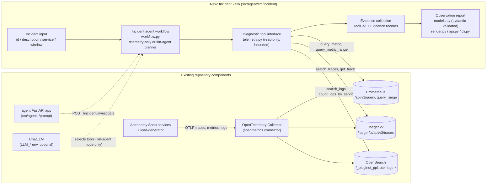

# Incident Zero: Checkpoint 1 (Eyes)

Incident Zero observes a live incident in the Astronomy Shop through read-only
telemetry tools. It returns a validated observation report together with an
auditable record of every query it ran. Root cause, remediation and rollback
are later milestones, and the report always says that the root cause is not
established.

## Architecture



## Investigation flow

1. **Input.** An `IncidentInput` holds an id and/or description, an optional
   service and a time window (default: the last 15 minutes, capped at 6 hours).
2. **Overview metrics.** Three instant queries over spanmetrics (server spans)
   give error ratio, request rate and p95 latency for every service.
3. **Pick a service.** The planner uses the service you supplied. Otherwise it
   uses a service named in the description, then the service with the highest
   error ratio, then the one with the highest p95 latency.
4. **Drill down.** For that service it runs error-ratio and latency timelines
   (peak value and timestamp), WARN+ logs and error traces from Jaeger. If
   there are no error traces, it samples recent traces instead.
5. **Follow-up.** If error traces show the deepest erroring span in another
   service, the planner queries that service's metrics and logs.
6. **Report.** Evidence is built only from successful tool results. Every
   finding is labelled as an observation or a hypothesis and cites evidence ids.
   Failed and empty calls are listed under unknowns. Validation rejects
   references that do not resolve.

Planner modes:

- **`telemetry-only`** (the default): the rule-based steps above. No LLM is
  involved, and the report says so.
- **`llm-agent`**: set `INCIDENT_LLM_ENABLED=True` and configure `LLM_BASE_URL`,
  `LLM_MODEL` and `API_KEY`. A LangChain agent picks the same read-only tools,
  and its text is stored separately as `llm_narrative`. If the LLM fails, the
  run falls back to `telemetry-only` and records the failure.

## Reproduce the demo

The checkpoint only needs the minimal stack (no Kafka and no agent containers):

```sh
make start-minimal          # or: docker compose ... compose.yaml + compose.observability.yaml + compose.extras.yaml
docker compose ps           # wait until frontend-proxy, prometheus, jaeger and opensearch are up
```

Run the investigation from the host. The load generator provides traffic:

```powershell
cd src/agent
$env:PROMETHEUS_URL = "http://localhost:9090"
$env:JAEGER_URL     = "http://localhost:8080"          # Jaeger is proxied by frontend-proxy at /jaeger/ui
$env:OPENSEARCH_URL = "http://" + ((docker port opensearch 9200 | Select-Object -First 1) -replace '0.0.0.0','localhost')
python -m src.incident.cli --incident-id DEMO-1 --description "Users report errors on the storefront" --json-out report.json
```

The output shows each tool call (why it ran, the exact PromQL, PPL or Jaeger
query, its status and duration, and the raw result), followed by findings,
trace links (`http://localhost:8080/jaeger/ui/trace/<id>`), evidence and
unknowns. To inject a real fault, turn on a flag at
`http://localhost:8080/feature/`, wait 2 to 3 minutes, then run the CLI again
without naming the service. The planner never reads flag configuration.

HTTP alternative: with `make start-agentic`, call
`POST /incident/investigate` (JSON) or `/incident/investigate/markdown` on the
agent service, port 8010.

Tests (run from `src/agent`):

```sh
python -m pytest tests -q                                  # unit tests, mocked HTTP
INCIDENT_LIVE=1 PROMETHEUS_URL=... JAEGER_URL=... OPENSEARCH_URL=... python -m pytest tests/test_incident_live.py -q
```

## Module ownership

| Module | Responsibility |
| --- | --- |
| `incident/telemetry.py` | Prometheus, Jaeger and OpenSearch adapters; bounded, read-only, error-capturing |
| `incident/workflow.py` | Planners (telemetry-only and LLM), prompt, report builder |
| `incident/models.py` | Input, evidence and report schema plus validation |
| `incident/render.py`, `api.py`, `cli.py` | Demo surfaces |
| `tests/` | Unit tests (mocked) and live smoke test |

No organizer report schema was found in the repository. The report uses
`schema_version: incident-zero/observation/v1` and should be mapped to the
official schema once it is available.
