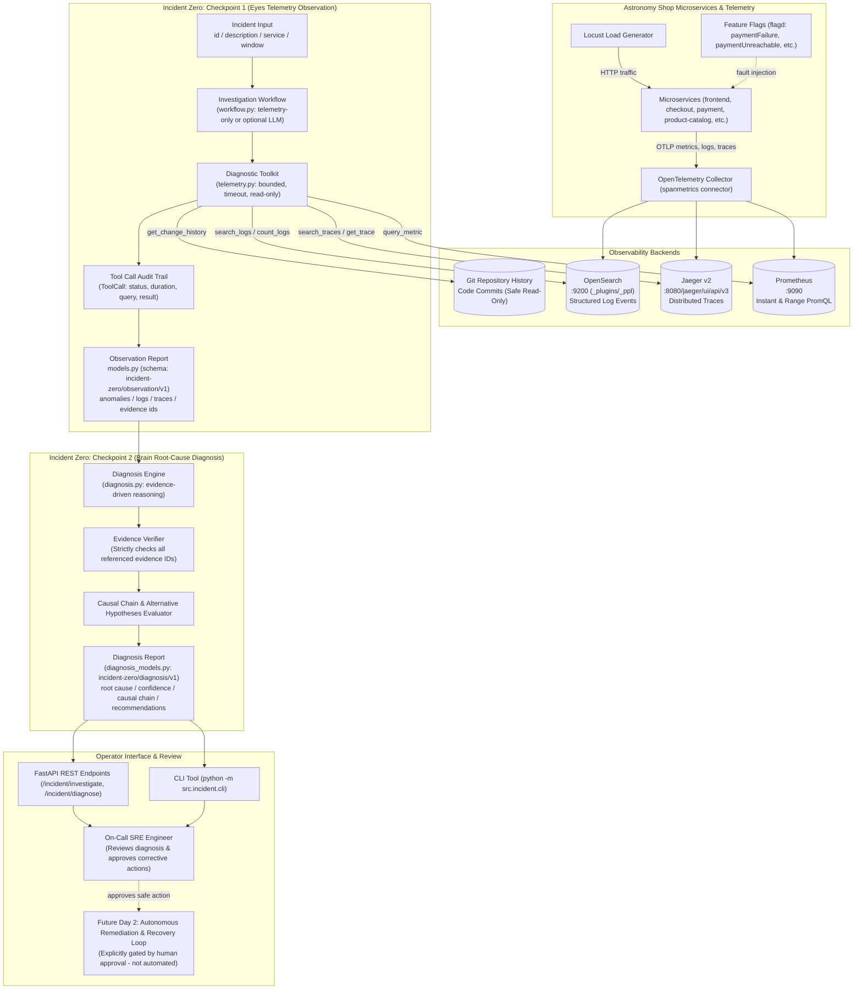

# Incident Zero: Checkpoint 1 (Eyes) & Checkpoint 2 (Brain) Architecture

## Overview
Incident Zero is an AI-powered on-call incident investigation and root-cause analysis agent designed for the OpenTelemetry Astronomy Shop.
- **Checkpoint 1 (Eyes)** queries real telemetry (Prometheus metrics, Jaeger distributed traces, OpenSearch logs) and code change history to construct an auditable, evidence-backed `ObservationReport`.
- **Checkpoint 2 (Brain)** consumes the validated `ObservationReport` and infers the root cause, maps the causal chain, assigns a confidence score, evaluates alternative hypotheses, and recommends safe, non-automated corrective actions in a validated `DiagnosisReport`.

## Architectural Components

### 1. Existing Demo & Telemetry Pipeline
- **Astronomy Shop Services**: Polyglot microservices (Go, C#, Java, Node.js, Ruby, PHP) instrumented with OpenTelemetry SDKs.
- **OpenTelemetry Collector**: Ingests traces and logs, generating Prometheus spanmetrics for server error ratios, request rates, and p95 latencies.
- **Flagd**: OpenFeature flag daemon managing controlled fault injections.

### 2. Observability Storage Backends
- **Prometheus**: Time-series metrics queried via PromQL instant vectors and bounded time ranges.
- **Jaeger v2**: Distributed trace queries via Jaeger UI API v3 (`/jaeger/ui/api/v3/traces`), extracting deepest failing spans.
- **OpenSearch**: Log aggregation queried via PPL (`/_plugins/_ppl`) with severity filtering (13=WARN, 17=ERROR).
- **Git Change History**: Read-only repository commit log analyzer reporting code-level modifications without claiming live deployment confirmation.

### 3. Eyes Observation Workflow (`src/agent/src/incident/`)
- **`telemetry.py`**: Fault-tolerant tool adapters with explicit limits, timeouts, error capturing, and NaN/infinity handling.
- **`workflow.py`**: Executes structured diagnostic plan across metrics, logs, traces, and code changes.
- **`models.py`**: Validates observation schema `incident-zero/observation/v1`. Programmatically validates that every finding references real, successful tool calls.

### 4. Brain Diagnosis Engine (`src/agent/src/incident/`)
- **`diagnosis.py`**: Consumes observation reports and derives:
  - Root cause component.
  - Causal propagation path from leaf fault to user-visible symptoms.
  - Mathematical confidence score (0.0 to 1.0) and status (`confirmed`, `probable`, `insufficient_evidence`).
  - Strict evidence citations (`supporting_evidence_ids` verified against observation evidence).
  - Alternative hypotheses with concrete rejection reasons.
  - Non-automated, safe operator recovery recommendations.
- **`diagnosis_models.py`**: Pydantic schema for `incident-zero/diagnosis/v1`.

### 5. Operator Interfaces
- **CLI**: `python -m src.incident.cli --incident-id <ID> --description "<desc>" --diagnose --json-out report.json --diagnosis-out diagnosis.json`
- **FastAPI**: Mounts `/incident/investigate` and `/incident/diagnose` supporting both structured JSON and formatted Markdown.
